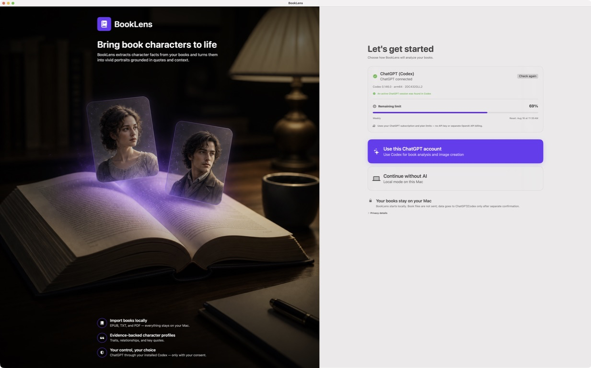
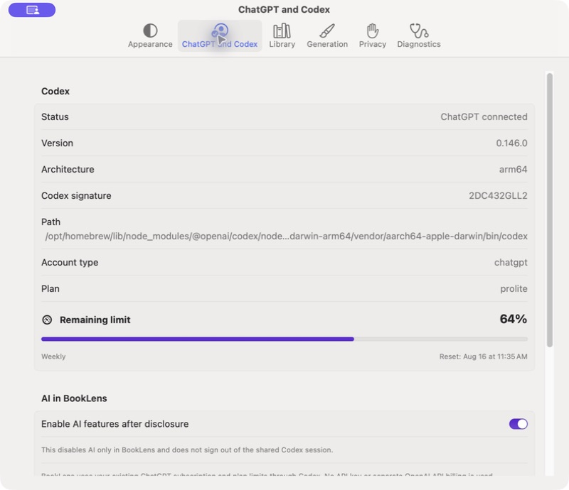
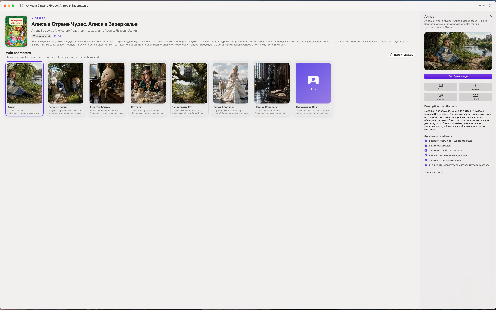
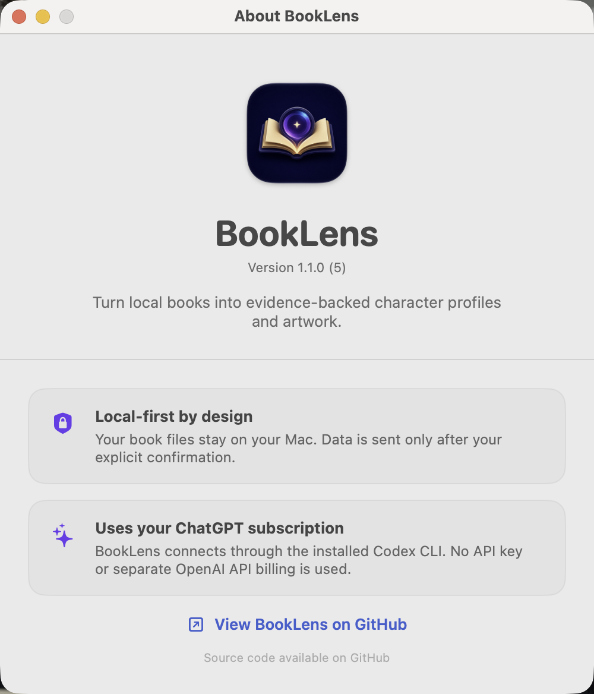

# BookLens

BookLens is a native macOS app that finds the main characters in a book and turns evidence from the text into portraits, full-body images, scenes, and book-world illustrations.

Import an EPUB, a text-based PDF, or a TXT file, or search for a book by title. Local files stay unchanged. BookLens extracts text locally, asks for confirmation before sending selected excerpts, and links confirmed character traits back to supporting evidence.

## Your ChatGPT subscription

> **BookLens uses your existing ChatGPT account and subscription through the locally installed Codex CLI.** Requests consume the limits of your ChatGPT plan. BookLens does not ask for an API key, does not support API-key mode, and does not create separate OpenAI API billing.

On first launch, BookLens safely checks the installed Codex version, the current account type, and the remaining plan limit. No book files or excerpts are sent during this readiness check. AI features remain disabled until the user explicitly chooses **Use this ChatGPT account**.

Signing in or out changes the shared Codex session on that Mac. BookLens never reads or stores passwords, tokens, `auth.json`, cookies, credentials, or API keys.

## Screenshots

| Onboarding and plan limit | ChatGPT and Codex settings |
| --- | --- |
|  |  |

| Evidence-backed character workspace | About BookLens |
| --- | --- |
|  |  |

## Features

- Native SwiftUI interface for macOS 15 and later.
- Local EPUB, TXT, and text-based PDF import.
- Read-only discovery of personal EPUB/PDF files from Apple Books; FairPlay DRM is identified and never bypassed.
- Evidence-backed character profiles with excerpts, traits, relationships, and confidence levels.
- Book and character search using public sources when no local file is available.
- Portrait, full-body, scene, and book-world image generation through `codex app-server` and `$imagegen`.
- Remaining ChatGPT/Codex plan limit and reset time shown in onboarding, the sidebar, and Settings.
- Local SwiftData library, artwork gallery, comparison, favorites, export, and primary-cover selection.
- Explicit confirmation before book analysis or image-generation data is sent.
- Opt-in metadata-only diagnostics with mandatory redaction.
- English and Russian interface with a System-language mode. Source books and quotations may be in any language.

## Requirements

- macOS 15 or later.
- Apple Silicon for the currently verified configuration.
- Xcode and Swift 6.1 or later.
- Codex CLI `0.146.0` or later with a compatible `app-server` protocol.
- A signed-in ChatGPT account for live AI analysis and generation.

Install Codex from the official [Codex CLI documentation](https://learn.chatgpt.com/docs/codex/cli). See [Codex authentication](https://learn.chatgpt.com/docs/auth) for supported account sign-in.

## Download

Download the current preview DMG from [GitHub Releases](https://github.com/Dezoff-max/BookLens/releases/tag/v1.0.1). The preview is ad-hoc signed but is not yet Developer ID signed or notarized, so macOS Gatekeeper may require explicit approval before the first launch.

## Build and run

```bash
swift build --scratch-path "${TMPDIR:-/tmp}/booklens-swiftpm-build" --product BookLens
swift test --scratch-path "${TMPDIR:-/tmp}/booklens-swiftpm-build"
./script/check_publication.sh --test
./script/build_and_run.sh --verify
```

Normal local launch:

```bash
./script/build_and_run.sh
```

Create a local DMG:

```bash
./script/create_dmg.sh
```

The default package is ad-hoc signed. Public binary distribution still requires a Developer ID Application certificate, notarization, and stapling; see [Documentation/NOTARIZATION.md](Documentation/NOTARIZATION.md).

## Architecture

```text
BookLensApp/                 SwiftUI presentation and application state
Packages/BookLensDomain/    Entities, validation, and service protocols
Packages/BookLensData/      SwiftData, storage, importers, and local search
Packages/BookLensCodex/     Codex process, JSON-RPC, analysis, and generation
Packages/BookLensSupport/   Typed errors, redaction, ImageIO, and SHA-256
Feasibility/BookLensSpike/  Live CLI feasibility harness
BookLensTests/              Unit and integration-oriented tests
Documentation/              Architecture, privacy, compatibility, and release notes
```

See [Documentation/ARCHITECTURE_DECISIONS.md](Documentation/ARCHITECTURE_DECISIONS.md) and [Documentation/CODEX_COMPATIBILITY.md](Documentation/CODEX_COMPATIBILITY.md).

## Privacy and security

- Local import does not require ChatGPT.
- Book analysis sends the title, author, headings, and at most 96,000 characters of selected excerpts only after confirmation. The original file is not sent.
- Image generation sends selected quotes, the character description, book context, and scene settings only after separate confirmation.
- Online search sends only the user's query.
- Diagnostics are off by default and never contain book text, full prompts, images, credentials, or unredacted private paths.

Read [Documentation/PRIVACY.md](Documentation/PRIVACY.md), [SECURITY.md](SECURITY.md), and [THIRD_PARTY_NOTICES.md](THIRD_PARTY_NOTICES.md).

## Project status

The source repository is prepared for public review. The local release bundle is buildable and testable, but the public binary release gates for Developer ID signing, clean-profile QA, notarization, and stapling must still be completed. See [Documentation/PUBLICATION_CHECKLIST.md](Documentation/PUBLICATION_CHECKLIST.md) and [Documentation/RELEASE_CHECKLIST.md](Documentation/RELEASE_CHECKLIST.md).

## License

BookLens is currently source-available and **not open source**. All rights are reserved. See [LICENSE](LICENSE).
